# The autonomy editor: a user guide

> **This guide is for TrainControl v3.0.0 and newer.**  Using v2.8.2 or older?  Autonomy worked differently then (a graph built in the Autonomy tab or written in JSON), and **[the guide for those versions](AutomationAPI.md)** describes it.  That guide also covers driving TrainControl from Java, which still works in v3.0.0.

This guide takes you from a track diagram with nothing set up on it to a layout that runs trains on its own. You do all of it in the **autonomy editor**, on the track diagram itself: there is no file to write and no code to run. The first half covers the editor: how to open it, what is on screen, and what each menu and tool does. The second half has worked examples, and what to do when trains will not move.

**Contents**

- [What you need](#what-you-need)
- [How autonomy works](#how-autonomy-works)
- [Getting started](#getting-started)
- [Setting up your railway](#setting-up-your-railway)
- [The editor at a glance](#the-editor-at-a-glance)
- [Saving, canceling, and changing page](#saving-canceling-and-changing-page)
- [Which way trains may run](#which-way-trains-may-run)
- [The right-click menu](#the-right-click-menu)
    - [The Station Settings window](#the-station-settings-window)
    - [The Train Placement tab](#the-train-placement-tab)
- [Bulk Tools](#bulk-tools)
- [Test a path, Why not Moving? and One-Way Run](#test-a-path-why-not-moving-and-one-way-run)
- [Keyboard shortcuts](#keyboard-shortcuts)
- [The setup check](#the-setup-check)
- [Example 1: a shuttle between two stations](#example-1-a-shuttle-between-two-stations)
- [Example 2: an oval with a passing loop](#example-2-an-oval-with-a-passing-loop)
- [Example 3: a terminus, and trains that must turn around](#example-3-a-terminus-and-trains-that-must-turn-around)
- [Example 4: a through station that only takes trains one way](#example-4-a-through-station-that-only-takes-trains-one-way)
- [Track lengths](#track-lengths)
- [Running and watching](#running-and-watching)
- [Trying it out without a Central Station](#trying-it-out-without-a-central-station)
- [Choosing how trains pick their route](#choosing-how-trains-pick-their-route)
- [Timetables](#timetables)
- [Sending every train home](#sending-every-train-home)
- [Autonomy settings](#autonomy-settings)
- [Configurations](#configurations)
- [When trains will not move](#when-trains-will-not-move)

---

## What you need

**S88 feedback sensors: required.** TrainControl knows where a train is only because a sensor tells it, so autonomy cannot run without them. Every station needs at least one S88 contact. Three is much better (before the stopping point, at it, and after it): then a train slows down as it arrives instead of stopping dead on the contact.

**Digital switches where routes divide: required.** Autonomy sets every switch on a train's route before the train sets off, so each switch your trains run through needs a decoder and an address TrainControl can set. A switch on the diagram with no address is listed under `Must be fixed` in the [setup check](#the-setup-check), and autonomy will not start until it has one.

**Digital signals: optional.** Autonomy does not need signals: it stops each train smoothly on its own sensors. Where you have signals, TrainControl sets the ones on a route to green along with its switches. It sets a signal back to red only where you pair it with a station: in a station's `Station Settings`, `Exit guard signal` keeps it red while a train stands there, and `Entry guard signal` turns it red when a train arrives. A signal you do not pair stays green. Guard signals look right and add a layer of safety; a station without one is only listed under `Worth tidying`.

**Switches you throw by hand, and signals that are only scenery.** Draw a hand-thrown switch with one of the track editor's *(Static)* switch tiles. Autonomy then runs trains through it only from its legs toward the points, where the position of the blades does not matter. Two `Y Switch (Static)` tiles drawn point to point count as a diagonal crossing. Every other switch and signal on a page autonomy uses needs its address. A scissor switch cannot be used, and trains are not run across a turntable. Leave out a page that is only a picture (`Exclude Page`).

**A track diagram stored on this computer.** Either download it from your Central Station with **Layouts → Download Central Station Layout Files**, or draw it in TrainControl's own editor. A diagram read from the Central Station each time TrainControl starts cannot store an autonomy setup, so download it first (the Autonomy menu offers to). The download asks before it replaces a layout already in the folder, and opens the copy when it is done. Autonomy is set up on this diagram, so if your diagram does not match your railway yet, start there.

After a sync from a diagram stored on this computer (at start-up, from `Locomotives` > `Sync Database w/ Central Station`, or when you open a layout), TrainControl compares the switch and signal squares of the stored diagram with the Central Station's own list. The log names each square at an address the Central Station has, but not in the square's protocol (MM2 or DCC). On a CS3 with an MM2 and a DCC accessory at one address, it also gives a hint where the CS3's own plan of the page puts the other one on that square. Nothing is changed: if the Central Station is right, set the square's protocol in the track diagram editor.

**Locomotives with addresses that work.** If you cannot drive a locomotive by hand from TrainControl, autonomy cannot either.

You do not need to describe your track anywhere else: TrainControl reads the diagram and works out which squares connect to which.

---

## How autonomy works

Autonomy rests on three things.

**Stations are where trains stop.** You do not create them: any sensor square on your diagram can become a station, because a sensor is what tells TrainControl that a train has arrived. You give stations names, and say which ones trains may stop at and which they only pass through.

**The track says where a train may go.** TrainControl traces the track on your diagram and works out the connections itself; you do not draw them. You close the few pieces of track you do not want used, such as a siding trains should keep out of, or a line that only makes sense in one direction.

**A train has to start somewhere.** You tell TrainControl which train stands at which station. From then on it keeps track of the trains itself.

Press start, and TrainControl picks a train, picks somewhere it can go, sets the switches and signals on the way, sends it, and watches the sensors until it arrives. Then it does it again.

The pictures in this guide show a small demo layout: an oval with stations Ashby and Bramley, a passing loop with Carlton, and a branch to a terminus, Thornbury. Their numbers are the steps below, and their letters the steps of [Example 1](#example-1-a-shuttle-between-two-stations).

---

## Getting started

**1. Make a configuration.** `Autonomy` → `Add a Configuration...`. TrainControl asks for a name (the first is "Autonomy 1"), reads your track diagram as it stands, and loads the result. Every sensor can now be a station, and trains will use the track between them. A configuration is one way of running your railway, and you can have several (see [Configurations](#configurations)).

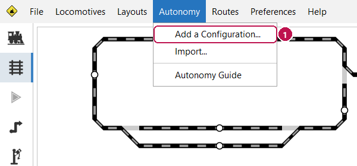

**2. Open the editor.** `Autonomy` → `Edit Autonomy on Page`, and pick your page. You can also open it from:

- **The strip above the track diagram.** When the setup has something to fix, the strip shows how many errors and warnings there are and how many of them are on this page, with a `Fix it` button in place of Start. The count and `Fix it` both open the editor on the first thing to deal with.
- **The track diagram's right-click menu.** Right-click a square → `Autonomy Setup` → `Open the Full Editor...` opens the editor on that square.
- **The editor itself.** The sidebar on the left switches between `Track Diagram` and `Autonomy Setup`, and between pages.
- **The Auto tab's Settings.** `Edit Autonomy Paths in Track Diagram` opens the autonomy editor.
- **The diagram's `Edit` button** and `Layouts` → `Edit/Add Pages...`. These open whichever editor you used last: the track diagram or the autonomy setup.

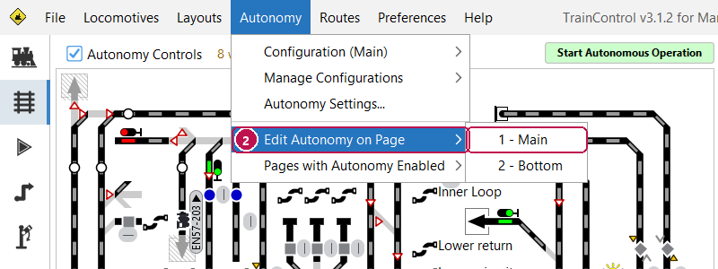

Only one editor window is open at a time; while it is open, any of these brings it to the front. The editor cannot be opened while autonomy or a route is running, so stop the trains first. While the editor is open, the Layouts and Autonomy menus start with `Go to the Opened Editor`, which brings it to the front. The rest of the Autonomy menu is grayed, each grayed item says `Close the editor to use this.`, and no train can be sent.

---

## Setting up your railway

A layout is ready to run once three things are done: the diagram matches the track, the places trains should stop are stations, and the trains and track are measured. The rest is optional. Work in this order, since each step relies on the one before.

**3. Make the track diagram match your railway.** Autonomy knows your track only from the diagram. Every switch and every crossing has to be on it, in its real place and joined up the way the track is, and each switch needs its real address. Each S88 contact goes on the square where it really sits, with its real address. A switch left off is a junction autonomy does not know about; a crossing left off lets it send two trains over the same diamond at once; a sensor on the wrong square stops trains in the wrong place. Do this in the track diagram editor (`Editing` → `Track Diagram`) before anything else, because the setup is read from it. If your track runs across pages or through tunnels, pair each page link and tunnel that track runs into: right-click it → `Pair with a Link...` and pick the link it leads to. An unpaired one is listed under `Must be fixed`. Untick `Autonomy Uses This Link` on any link that is only part of the drawing.

**4. Make a station of each sensor where trains should stop.** A sensor is not a station until you make it one. Right-click each sensor where you want trains to stop and choose `Station Settings...` (or point at it and press Control+O), then click the `Station` button or tick `Trains can stop here`. A sensor with no name yet asks for one, and a name another square already has is refused; you can change it later in the window's `Name` box. [The Station Settings window](#the-station-settings-window) explains the rest of the window. `Bulk Tools` → `Name Everything...` visits a page's unnamed sensors in turn, and `Mass Edit...` sets several stations alike. Leave the other sensors as they are: the ones before and after a platform, and the ones that follow a train through a junction, are for passing. A station at the end of a line is a `Terminus` (see [Example 3](#example-3-a-terminus-and-trains-that-must-turn-around)).

**5. Measure your trains and your track.** Pick a unit and use it everywhere. `Bulk Tools` → `Mass Assign Train Lengths (... missing)...` asks for each train's length, and `Mass Assign Lengths...` asks for the track's, a stretch at a time. Tick `Unmeasured Track` under `Visible Elements` to see what is left. Autonomy runs without lengths, but then it cannot tell whether a train fits a station or how much track a standing train covers, and it keeps each train's whole route reserved until the train arrives. [Track lengths](#track-lengths) says what each number does, and what to measure first.

**6. Place your trains.** Right-click the station each train is standing at, choose `Place a Locomotive Here...`, and pick the train in the `Train` list of the window that opens. From then on TrainControl keeps track of them. While autonomy is stopped, you can also drag a train on the diagram from one station to another.

**7. Check, save and start.** `Things to look at` lists anything still to do. When the line under it says the setup is ready to run, press `Save Changes`, then `Start Autonomous Operation` on the strip above the track diagram. To try it first without a Central Station, see [Trying it out without a Central Station](#trying-it-out-without-a-central-station).

**Optional, when you want them:**

- **Guard signals.** In a station's `Station Settings`, `Exit guard signal` keeps signals at red while a train stands there or is on its way, and turns them green as a train leaves; `Entry guard signal` turns them red when a train arrives. The pencil beside each picks the signals. Guard signals are for looks and an extra layer of safety: autonomy stops trains on their sensors either way.
- **Exclusions.** Keep trains off what they should not use:
    - Click track to make it one way or close it (or use `Trains May Depart...`).
    - Leave a whole page out with `Exclude Page`.
    - Take a station out of service by unticking both `Trains can stop here` and `Trains can pass through` in its `Station Settings`.
    - Click `Parking` for a berth only you and Return Home will use, or untick only `May choose this station` to keep the station's other settings. A `Parking` berth is a terminus, so if track reaches it from both ends, leave only one side ticked under `May arrive from`. Until you do, the setup check lists it under `Must be fixed` and autonomy will not start.
    - Keep particular trains from stopping at a station, or from passing a sensor that is not a station, with `Allowed trains` under `Advanced`.
- **Advanced settings.** A station's `Station Settings` has `Importance`, `Speed into here` and `Unavailable while` under `Advanced`. `Maximum train length` and `May arrive from` (the sides the station takes trains from) are under `Trains can stop here`. Settings for the whole layout (delays, speeds, how many trains run at once) are on the Auto tab: see [Autonomy settings](#autonomy-settings).

---

## The editor at a glance

The window's title is "Autonomy Editor: *page* (*configuration*)". The sidebar is on the left, your diagram in the middle, and tools and settings on the right.

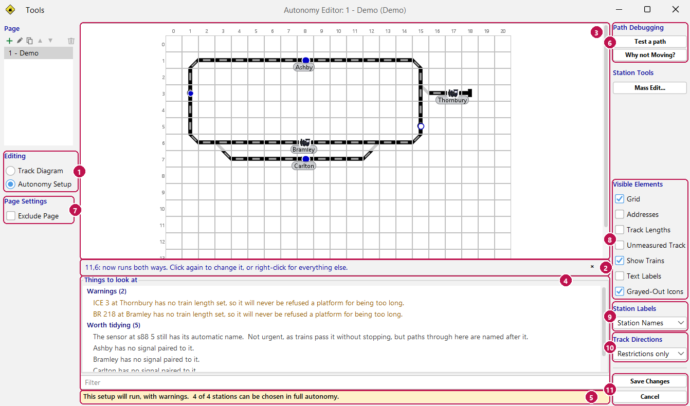

- **`Editing`**: `Track Diagram` switches to drawing track and `Autonomy Setup` to setting up autonomy, on the same page. A `Page` list above it moves between pages.
- **The message strip** says what just happened and what to do next.
- **Your diagram.** Click track to set which way trains may run; right-click any square for everything else. Hover over a station to see its name. Signals and lamps are drawn in gray to keep the picture simple; while you pick a guard signal, the signals you can pick are in color.
- **`Things to look at`** lists what the [setup check](#the-setup-check) has found. Click a finding to go to its square, or double-click it (or press Control+O) to open that station's `Station Settings`. The `Filter` box under the list narrows it as you type: it matches any part of a row's words, ignoring capitals, and the counts elsewhere still count everything.
- **The line under it** says whether the setup is ready to run.
- **`Path Debugging`**: `Test a path` and `Why not Moving?`. Each answers both for autonomy choosing a destination and for a train you send yourself (and Return Home); see [Test a path, Why not Moving? and One-Way Run](#test-a-path-why-not-moving-and-one-way-run).
- **`Page Settings`**: `Exclude Page` leaves this whole page out of autonomy: its sensors stop being stations and nothing on it is driven. Put it back from `Autonomy` → `Pages with Autonomy Enabled`.
- **`Visible Elements`**: `Grid` (Control+K); `Addresses` (Control+D); `Track Lengths`, each square's recorded length (Control+G); `Unmeasured Track`, the track with no length yet; `Show Trains`, whether the editor draws the trains standing on its diagram (the track diagram's own are not affected); `Text Labels`, whether your own text on the diagram is drawn; and `Grayed-out Icons`, whether the squares autonomy ignores are drawn grayed out or left empty.
- **`Station Labels`** chooses what the station captions show: `Station Names`, `Standing Locs` (the train standing there), `Home Locs` (the station's home locomotive), or `Hide`. Control+L steps through them.
- **`Track Directions`** chooses which direction marks are drawn: `Show All`, `Restrictions only` (only the directions you have shut; the usual choice), `Allowed only` (only the directions trains may run), `Hide All`, or `Station Arrivals` (the sides each station takes trains from).
- **`Save Changes`** and **`Cancel`**: see [Saving, canceling, and changing page](#saving-canceling-and-changing-page).

The editor remembers the visibility settings between openings.

**Pages.** Under `Page`, a strip of icons adds, duplicates, renames and deletes the page you are on, and moves it up or down. Pages are listed in the order of the layout's files. The window's `Tools` menu has what the icons do not, such as `Sort Pages by Name`. In the autonomy setup it also has `Find a Point...` (Control+F), which goes to a point by its name on any page.

**Moving a train.** With `Show Trains` ticked and autonomy stopped, drag a train from its station to another station. This is the same as cutting and pasting it: the train keeps its facing, nothing is asked, and `Cancel` undoes every move. From the keyboard, point at a station and press Control+V to put the locomotive selected in the main window there, or Delete to take its train off.

**Several stations at once.** `Mass Edit...`, under the `Station Tools` heading, is a tool: it outlines in gray every station you can pick. Click stations to pick them or let them go, and `Station Settings` then changes every station picked. See [the Station Settings window](#the-station-settings-window).

---

## Saving, canceling, and changing page

**Changes take effect as you make them.** With a configuration loaded, the railway is rebuilt after each change, so Test a path and the diagram always show the setup as you have it. There is no undo; there is Cancel.

**`Save Changes`** (Control+Enter) writes the setup and closes the editor. Errors do not stop you saving, since you may be partway through, but a setup with errors cannot run. If the saved setup cannot be built at all (a page link left unpaired, for example), the railway keeps the last setup that worked, and the strip above the diagram says **Setup changes not applied yet** until the setup builds again.

**`Cancel`**, Escape, or the window's close box throws away everything changed since the editor opened, after asking. With nothing changed it just closes. Cancel puts every train back where it stood when the editor opened, and its question names the trains that will move. A train you pause or set going from its card on the Auto tab keeps what you did. Cancel never turns a train around: each keeps the way it faces now, whether you changed it in the editor or turned it with the throttle, a handset or a route. A train whose only change is its facing is not named.

**Changing page or mode** with unsaved changes asks first: `Save and Continue`, `Discard and Continue`, or `Stay Here`. So does quitting TrainControl with the editor open. Clicking a finding on another page goes there without asking, and keeps what you have done so far.

**Changing the track diagram later.** When you change the track diagram, autonomy reads it again. A square you move in the track diagram editor takes its station name, length and directions with it. A square you delete loses them, and TrainControl tells you which. Look at `Things to look at` again after any diagram change. The setup is kept in the layout folder, under `config/autonomy`, beside the diagram's own pages, so back up the whole layout folder, or use `Back Up TrainControl Data...` in the File menu.

---

## Which way trains may run

With no tool armed, a left-click on track changes which way trains may run on it, and the message strip says what it is now.

- **Plain track**: each click changes the whole run of plain track between two switches or sensors, in this order: both ways, one way, the other way, closed, and back to both ways.
- **A switch, crossing or double curve**: each click steps to the next combination of open arms, the common ones first: all open, each route on its own, closed, then the rest. You can also tick the arms one by one from the right-click menu.
- **An s88 square** (a sensor, whether a station or not): a click opens its `Station Settings`, so a double-click on a station opens them too, even while autonomy runs (read only then). Its arrows are set under `May depart` there.
- **A page link or tunnel** has no direction of its own: set the track leading up to it.
- **A route button drawn on the track** is set on its own: a click changes that square only. One with no track running through it is grayed and ignores clicks.
- **A square out of service** (both `Trains can stop here` and `Trains can pass through` unticked) is a sensor too, with no arrows drawn on it: a click opens its `Station Settings`.

**Shift+click** picks several squares (outlined in orange), so that one `Segment Length...` gives them all the same length. **Drag a station's caption** to move it to another free square on the same page.

---

## The right-click menu

Right-click any square for everything else. The menu opens with the square's name as a heading (on plain track, what it is, such as `Straight Track`), with `Station Settings...` right under it where the square has one. The menu offers only what makes sense for that square, and settings on plain track act on the whole run.

On the track diagram, the items about the square come first. `Segment Length...` and the editor's other items for the square, `Bulk Tools` and `Open the Full Editor...` are under `Autonomy Setup` near the bottom, and `Start Autonomous Operation` and `Return Locomotives Home` (or `Gracefully Stop Autonomy`) come last. While an editor is open, the track diagram's menu says so and offers `Go to the Opened Editor`.

While trains are running (autonomy, a timetable, a route, a train you sent, or Return Home), nothing on the menu can be changed except `Is Active` on the track diagram. `Station Settings` still opens, read only, except `Active` on its `Train Placement` tab when you open it from the track diagram.

### On a sensor or a station

| Item | What it does |
| --- | --- |
| *train* `Is Active` | Untick it to pause the train: autonomy and Return Home then leave it where it stands. On the track diagram it stays on the menu while trains are running, and then pauses that train alone, as the pause button on the train's card on the Auto tab does |
| `Change Direction (now facing` *East* `)` | Turns the train standing here around. If you are not sure which way it faces, leave it: autonomy corrects it the first time the train runs. Where the track lets a train face only one way, the item is left off the track diagram's menu, and grayed in the editor with the reason. Where no track leads out, it is grayed on both |
| `Change Arrived From (currently` *West* `)` | Switches the side the train came in by, which is where its tail lies, to the other side. Where there is more than one other side, it opens a list of them. Where track reaches the square from one side only, it is left off the track diagram's menu and grayed in the editor |
| *train*`'s Tail Reaches Back To...` | Only where it matters: which sensor behind the train its tail has crossed. `Pick on the diagram...` lets you click it |
| `Station Settings...` | Opens the window with every setting of the station (Control+O): see [the Station Settings window](#the-station-settings-window) |
| `Change Train at` *station* `...` / `Place a Locomotive Here...` | Opens `Station Settings` on its `Train Placement` tab: which train is standing here, and how it stands. On a station with no train it puts one there. It reads `Place Another Locomotive Here...` when `Place` *train* `Here` is beside it. See [the Train Placement tab](#the-train-placement-tab) |
| `Place` *train* `Here` | When a train is selected in the main window and is not the one standing here: puts it here (Control+V) |
| `Remove` *train* | Takes the train off this square (Delete) |
| `Edit` *train* `...` | On the track diagram only, when a train is standing here: opens that train's `Locomotive Settings` on the `Autonomy` tab. It opens grayed out while autonomy runs |
| `Segment Length...` | How long this piece of track counts as, in your own units (Control+E); see [Track lengths](#track-lengths). On the track diagram it is under `Autonomy Setup` |
| `Show a Station Name Here...` | Puts a station's caption on this square (Control+N). A page shows each station once: if the station already has a caption on this page, the caption moves here, and its captions on other pages stay. `Stop Showing` *station* takes off the caption on this square only |
| `Bulk Tools` | See [Bulk Tools](#bulk-tools). On the track diagram it is under `Autonomy Setup` |

Everything else about a station is in its `Station Settings`: its name, whether trains stop or run through, which sides they arrive from and leave by, its guard signals, home locomotive, importance, and the trains kept out. Control+S still names the square under the pointer, and Control+H sets its home locomotive.

### The Station Settings window

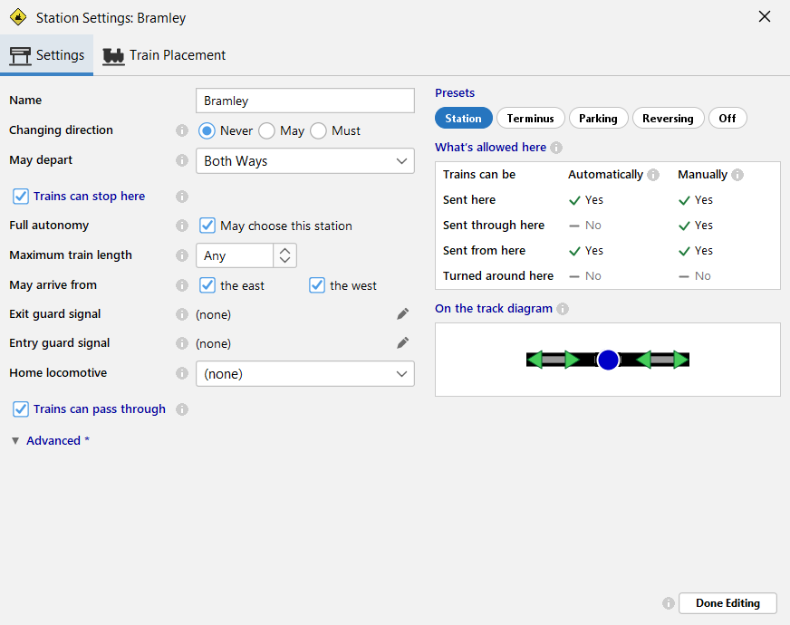

`Station Settings...` opens one window for the station you right-clicked. In the autonomy editor it first opens to the right of the editor, or over the editor's right-hand column where the screen has no room to the right. From the track diagram it opens to the right of that window where there is room. It stays open beside the diagram: right-click another square, or point at one and press Control+O, and it shows that one. In the autonomy editor every change goes straight into the editor's draft, so the editor's `Cancel` undoes it; on the track diagram each change is saved at once. `Done Editing`, at the bottom right (Control+Enter), closes the window. While autonomy runs, the window opens but nothing in it can be changed. An (i) beside a setting says what it is set to now and what changing it does: rest the pointer on it, or click it to read it at once.

**The settings, from the top of the left-hand column:**

- `Name`: the station's name. It is left out when you set several stations at once.
- `Changing direction` sits above both boxes because it applies to both: `Never`, `May` (a train may stop, reverse and carry on, to reach a siding behind it) or `Must` (every train turns around: a terminus, or a berth trains back into). It grays out when both boxes are unticked.
- `May depart` sits under it, above both boxes too, as it belongs to neither. It sets the sides trains may leave by, `Both Ways` or `One Way, Toward` a side, and changes the arrows on the station's own square and nothing else.
    - Where the track on one side runs out before it reaches another sensor, as at a terminus at the end of a line, trains can only leave the other way. `May depart` then shows that way grayed, and its (i) says why.
    - Elsewhere you can change it. A direction that leaves trains sent here no way out is listed under `Things to look at`, and shown in a red notice under the picture.
    - It is grayed when both boxes are unticked, as it also says how a stopped train leaves.
    - There is no `Closed` choice. To keep trains from stopping here, untick `Trains can stop here` or press `Off`; to take the square out of service, untick both boxes. A station closed by an earlier version stays closed, and shows no choice until you pick one.
- `Trains can stop here`: whether the square is a station. Unticked, nothing stops here and the settings under it gray out. Under it:
    - `May choose this station`: untick it and autonomy never chooses the station, though Return Home and the trips you send by hand still use it. This is for a parking berth.
    - `Maximum train length`: the longest train that may be sent here. Its arrows step the number up and down. At 0 it shows `Any`, meaning a train of any length; typing `Any` or 0, or leaving the box blank, means the same. A change, typed or made with the arrows, takes effect when you press Enter or leave the box.
    - `May arrive from`: a box for each side trains may arrive from and stop. One side must stay open. Trains can still run through from a side that is closed. On a square that no track leads a train onto, it says `(none)`, as there is no side to choose.
    - `Exit guard signal` and `Entry guard signal`: the signals that follow the station. The pencil beside each picks them, in a window that opens just under `Station Settings`. Add a signal with `Click It on the Diagram` or `Enter Its Address...`, and take one off with the red X at the end of its row.
    - `Home locomotive`: the train Return Home brings back here, or `(none)`.
- `Trains can pass through`: whether trains may pass over the square without stopping.
- `Advanced`, folded away until you open it, and marked with a `*` while a setting under it is not at its default (or, for several stations, while they differ on one): `Importance` (higher is chosen first; 0 is the default; a negative one makes the station a last choice, used only when no station at 0 or above is free), `Speed into here` (trains run at this percentage of their speed on the track leading in), `Allowed trains` and `Unavailable while`.
    - `Allowed trains` is `All`, `Blacklist` or `Whitelist`. For the last two, the pencil beside it opens the list of trains. A blacklisted train may not stop here, though it can still pass through; on a sensor that is not a station it may not pass at all. On a whitelist only the trains you pick are allowed: every other train, including any you add later, is kept out, and an empty whitelist keeps every train out. Going back to `All` keeps the list for next time.
    - `Unavailable while` lists other stations that keep trains away from this one while they are occupied.

**`Presets`**, at the top of the right-hand column (above the other settings when you set several stations at once), has five buttons: `Station`, `Terminus`, `Parking`, `Reversing` and `Off`. Each sets the settings in its row of the table below and leaves everything else as it was. A button shows as pressed whenever those settings match its row, however they got there.

- `Terminus` and `Parking` make a station trains must stop at, so neither shows as pressed for a station trains can pass through. A station set up in an earlier version keeps letting trains through until you press one of them.
- `Parking` is `Terminus` with `May choose this station` unticked: every train turns around there, and only you and Return Home send trains there. A station set up with the earlier `Parking`, where trains did not turn around, keeps its settings, and then no button shows as pressed.
- `Off` makes the sensor no station: trains run over it and never stop there.

| Button | `Trains can stop here` | `Trains can pass through` | `May choose this station` | `Changing direction` |
| --- | --- | --- | --- | --- |
| `Station` | on | on | on | `Never` |
| `Terminus` | on | off | on | `Must` |
| `Parking` | on | off | off | `Must` |
| `Reversing` | on | on | off | `May` |
| `Off` | off | on | (grayed, left as it is) | `Never` |

**What the two boxes mean together.**

| `Trains can stop here` | `Trains can pass through` | What the square is |
| --- | --- | --- |
| on | on | A station: trains may stop here, or run through |
| off | on | Pass-through: trains run over it, none stops (an ordinary sensor) |
| on | off | A station trains must stop at: no trip runs through it, though a train needn't turn around |
| off | off | Out of service: nothing can pass, though a train already there can still be sent out |

A station with only `Trains can stop here` ticked is not a terminus: a train may set off again the way it was going, as `May depart` allows. Autonomy and the trips you send by hand won't plan a route through it. Return Home is the exception, and may run through it.

**The picture, `On the track diagram`.** The station and the track beside it, with the same arrows as the track diagram, on the station too. Click the station to change `May depart` to its next choice. Once `May arrive from` closes a side, an arrow into the station shows each side: yellow where trains may arrive and stop, gray where they may not. A station that takes trains from every side shows none, as on the track diagram. The track beside it shows which way trains may run over it, even where the track diagram draws that arrow further along the track: green where trains may run that way, a red outline where they may not. Track that points opposite ways, which no train can pass, is shown closed. Click a way into the station to change it, or a neighbor's arrow to set that whole stretch of track, as its right-click menu does. When that lets trains go a new way that track further along the line still forbids (past sensors that are not stations, through switches where the line joins and through track that already allows it, up to the next station or a switch where it splits), every square that would change is highlighted and TrainControl asks `Change the rest of the line too?`: `Up to Next Station` changes them all, `Only Clicked Track` only the stretch you clicked. A signal beside the station is drawn in gray, as the autonomy editor draws signals, and nothing in the picture is faded. The picture shows no live state: signals and switches are drawn at rest (a switch straight), whatever they show on the railway.

**The table, `What's allowed here`.** For `Sent here`, `Sent through here`, `Sent from here` and `Turned around here`, it says `Yes`, `Some trains` or `No`, both for trains chosen `Automatically` by autonomy and for trains sent `Manually` from the right-click menu. Rest the pointer on a cell for the reason.

- Where a station has a `Maximum train length` or an `Allowed trains` list, a cell for a trip that ends there says `Some trains` instead of `Yes`. Resting the pointer on `Some trains` lists each condition a train must meet, by the setting it comes from: `Maximum train length`, `Allowed trains`, and `Changing direction` where only a train that can reverse may use the station.
- On a square that is not a station, `Sent through here`, `Sent from here` and `Turned around here` follow its `Allowed trains` list too, and say `No` for an empty whitelist.
- A setting that would leave a train here unable to leave again, which the setup check reports, is said in red under the picture.

The table reads the standing rules only, not who is on the track now, and none of it limits driving a train with the throttle. Return Home follows the same rules, with three exceptions: it won't start from a closed or non-station square, it may run through a station set to stop only, and it may bring a train that can't reverse to its own home at a station where every train must.

**Several stations at once.** With `Mass Edit...` armed (it is under the `Station Tools` heading), each station you can pick has a gray outline. Click a station to pick it (it is drawn with a teal band), and click it again to let it go. The window's title then says how many are picked, a green banner names the first four and how many more (hover over it for the full list), and the changes you make go to all of them.

- A setting the stations disagree on shows a warning triangle instead of a value (hover over it to read why), and is left alone until you change it. Such a field is blank, and leaving it blank changes nothing: type 0 or `Any` in `Maximum train length` for any length, or 0 in `Importance` for the default. An arrow on the blank length box steps to `Any` first.
- You can set the five buttons, the two boxes, `May choose this station`, `Maximum train length`, `Changing direction`, `Importance`, `Speed into here` and `Allowed trains` this way. The settings that belong to one station, such as its sides, guards and home, are hidden.
- If you decline a question partway, the rest of the stations are left alone and the strip says how many changed.
- Putting the tool down, Escape, a right-click or Control+O lets go of the picks and closes the window. Picking works while autonomy runs, and the window is then read only.

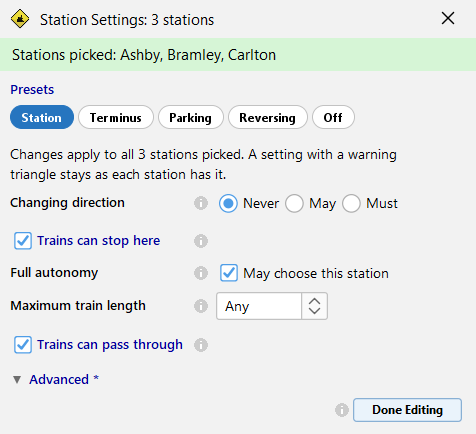

### The Train Placement tab

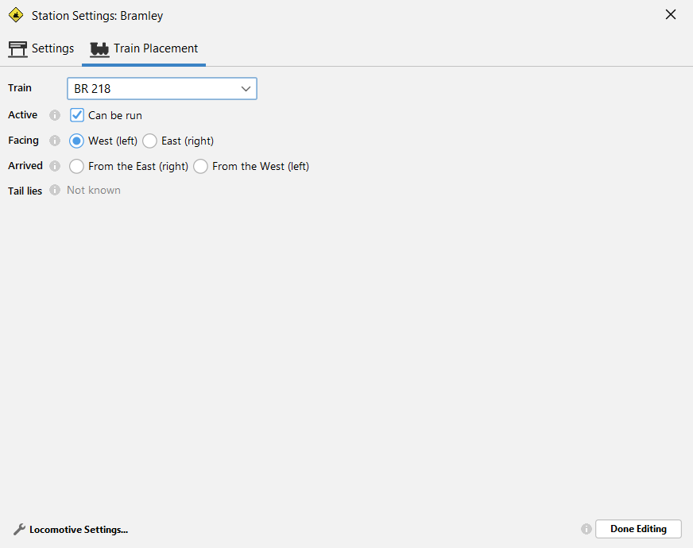

`Station Settings` for one station has two tabs, `Settings` and `Train Placement`. On a station with a train on it, `Change Train at` *station* `...` opens the `Train Placement` tab; on an empty one, `Place a Locomotive Here...` does. The tab has:

- `Train`: the locomotive standing here. Pick another to put it here, or `(none)` to take it off.
- `Locomotive Settings...`: opens the `Autonomy` tab of that locomotive's `Locomotive Settings`, with its `Train Length`, `Reversible`, `Active`, and the `Departure Function` and `Arrival Function` switched as it sets off and arrives.
- `Active`: untick it to pause the train, as on its card on the Auto tab. On the track diagram it also works while trains are running (autonomy, a timetable, a route, a train you sent, or Return Home), and then pauses that train alone.
- `Facing`, `Arrived` and `Tail lies`: which way the train points, which side it came in by, and where its tail lies, as `Change Direction` and `Change Arrived From` above set them. In the autonomy editor, `Pick...` lets you click the sensor on the diagram. While you pick, `Station Settings` is hidden so it does not cover the diagram, and it comes back when the pick ends.

Putting a train here asks which way it came in, and where its tail lies, as the other ways of placing a train do. While trains are running (autonomy, a timetable, a route, a train you sent, or Return Home), everything on the tab is read only, except `Active` when you opened the window from the track diagram.

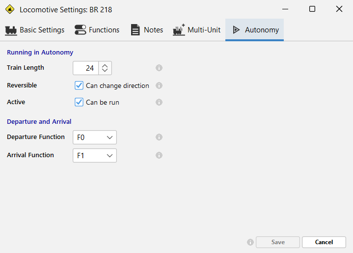

### On track, switches and signals

- **`Trains May Depart...`** on plain track and signals: `Both Ways`, `One Way, Toward` *a compass point*, or `Closed - No Trains`. On a switch or crossing, tick each side trains may leave by (`The N Side` and so on), or open or close `Every Branch of This Switch` at once. On a switch, three-way switch or double slip, the arrows decide everything: a train may run through it exactly where the side it leaves by is green. To keep trains out of a branch altogether, close the track beyond it. A crossing still sets each road on its own (`Branch E to W`...).
- **`Segment Length...`**, and on plain track and crossings the caption item, `Show a Station Name Here...`.

Names cannot be put on switches or signals.

### On a page link or tunnel

| Item | What it does |
| --- | --- |
| `Autonomy Uses This Link` | On by default. Untick it for a link that is only part of the drawing: it then carries no trains, is grayed on the diagram, and is not reported as unpaired |
| `Pair with a Link...` | Which link this one leads to. Links on other pages are listed too, and each flashes on the diagram as you go through the list. Page links pair with page links, and tunnels with tunnels on the same page |
| `Go to the Other End (...)...`, `Unpair This Link` | Once it is paired |
| `Name...`, `Segment Length...` | The link's name, and the length of track it stands for |

### On text and empty squares

`Show a Station Name Here...` puts a station's caption here. Over your own text it asks first, because the caption is drawn and your text is hidden. It is grayed on a square outside the part of the page the track diagram draws. A station is shown once on each page, so on a page where it already has a caption, that caption moves here; on another page, this one is added.

---

## Bulk Tools

`Bulk Tools` is the last item of every right-click menu in the editor, and is under `Autonomy Setup` on the track diagram's. Its items act on the whole setup instead of one square.

| Item | What it does |
| --- | --- |
| `One-Way Run` | Arms a tool that closes a run of track to one direction; see [One-Way Run](#test-a-path-why-not-moving-and-one-way-run) |
| `Name Everything...` | Visits each unnamed sensor on this page in turn and asks for its name (`Skip` moves on) |
| `Mass Assign Lengths...` | Walks each stretch of track on this page with no length, then asks one length for all its switches and one for all its crossings |
| `Mass Assign Station Max Train Lengths...` | Walks each station on this page with no maximum train length |
| `Mass Assign Train Lengths (... missing)...` | Walks each train autonomy would run that has no length of its own. The length is saved on the locomotive itself |
| `Clear All Locomotives`, `Clear All Home Locomotives` | Takes every train off, or forgets every home; Cancel puts them back |
| `Clear All Track Lengths`, `Clear All Station Max Train Lengths` | Starts the measurements over, on every page |
| `Allow Every Path` | Opens every one-way or closed piece of track both ways, on every page; Cancel puts them back. Track that can only ever run one way stays as it is |
| `Home All Trains Where They Stand` | Makes each train's present station its home |
| `Place All Trains at Their Homes` | Puts each train that has a home on it, facing the way it was homed, and takes the trains without a home off.  Nothing is sent to the railway: only where autonomy believes the trains stand changes |
| `Activate All Trains` | Sets every paused train going again, on the layout or not; the same as ticking `Is Active` on each. Grayed when no train is paused |
| `Deactivate All Trains` | Pauses every train on the layout: autonomy and Return Home leave each one where it stands. Trains that are not on the layout are left as they are. Grayed when no train on the layout is going |

Each "Clear" asks first, and says how many it would clear.

---

## Test a path, Why not Moving? and One-Way Run

A tool stays armed until you press its button again, press Escape, or right-click.

**`Test a path`** answers "could a train get from here to there?" Click the sensor a train would start from, then the sensor it should reach. The route autonomy would take there is drawn in yellow and the route back in amber, and the message strip says how many routes there are each way, or "no way through". Where autonomy has no way but a train you send yourself has one, that leg is drawn in purple, and the strip says why: the station is one autonomy is told to leave alone. A way that needs a switch set two ways at once (out along a spur and back through the same switch, for example) is no way, as the railway itself would refuse it. The tool uses the setup as you have it, unsaved changes included.

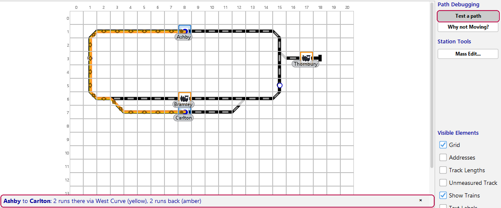

**`Why not Moving?`** answers "why is this train not being sent anywhere?" Click the square a train is standing on. The message strip says how many stations the train can go to now, then shows a table of the stations. Each row says whether the train **Can go now**, can go **By hand only** (autonomy will not send it there, but you can), or **Not right now**, and the reason: occupied and by whom, switched off, excluded, too short, no track at all, or why autonomy will not go there. A By hand only station that is the train's home also says `Return Home only`, as Return Home still takes it there. Each station is marked on the diagram in its row's color (green, purple or gray), and the route to each green or purple one is drawn on the track. A train with somewhere to go draws lines; a train with nowhere to go draws none. This tool reads the configuration as last **saved**: if you have unsaved changes, it says so.

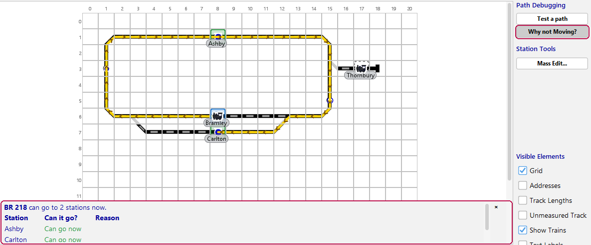

**`One-Way Run`** (in `Bulk Tools`) closes a stretch of track to one direction in two clicks: click one end of the run, then the far end, and choose `From A to B` or `From B to A`. It stays armed for the next pair.

---

## Keyboard shortcuts

These act on the square under the pointer.

| Keys | What they do |
| --- | --- |
| Control+S | Name the square |
| Control+O | Station Settings (for the square, or, with the pointer off the diagram, for the finding chosen in the list) |
| Control+E | Segment Length... (every picked square, with a Shift+click selection) |
| Control+N | Show a Station Name Here... |
| Control+B | The station's `Maximum train length` |
| Control+H | The station's home locomotive |
| Control+V | Put the locomotive selected in the main window on the station |
| Delete | Take the train off the square |
| Control+F | Find a Point... (the autonomy setup only) |
| Control+G | Show or hide Track Lengths |
| Control+L | Step through the Station Labels choices |
| Control+D | Show or hide Addresses |
| Control+K | Show or hide the Grid |
| + and - | Next and previous page (the number pad ones too) |
| Control+Enter | Save Changes in the editor; Done Editing in Station Settings |
| Double-click a finding | Station Settings for its station |
| Shift+click | Pick a square, or let it go |
| Escape | Put down an armed tool; with nothing armed, the same as Cancel |

The track editor's other keys, such as copy, rotate and undo, do nothing here.

---

## The setup check

The setup is checked as you go, and everything the check finds is listed under **Things to look at** at the bottom of the editor: this page first, then the others, each marked with its page. Click a finding to go to the square it is about.

- **`Must be fixed`** (red): errors. While the setup has any, autonomy will not start, and no train can be sent by Start, Execute Timetable, Return Home, or by hand. Among them:
    - a station that still has its automatic name, or is shown nowhere on the diagram;
    - a station whose name is shown twice on the same page of the diagram (right-click all but one of them and choose `Stop Showing` *station*);
    - the same locomotive on two squares;
    - two pages sharing one sensor;
    - a page link that track runs into but that is not paired;
    - a switch with no address;
    - a train facing a way its square no longer allows (turn it with `Change Direction`, move it, or put the track back);
    - a station at the end of a line where trains may not change direction (click `Terminus` in its `Station Settings`, set `Changing direction` to `Must`, or make it no station);
    - a station where every train turns around, such as a terminus or a parking berth, that track reaches from more than one side (leave only one side ticked under `May arrive from`, set `Changing direction` to `May`, or correct the diagram).
- **`Warnings`** (amber): worth knowing, but they stop nothing. For example: a train facing track that runs only toward it is not sent that way; a station no other station can reach; a station no train can leave for any other station (a way that needs a switch set both ways, or runs past a station before it can stop there, does not count); a train or station with no length while others have one.
- **`Worth tidying`** (gray): small things, such as an unnamed sensor that is not a station, a station with no guard signal, or two sensors with no track between them (a page link or tunnel counts as none).

The line under the list says where you stand: "This setup is ready to run", "This setup will run, with warnings", or how many things must be fixed first. It also says how many of your stations autonomy can choose.

Outside the editor, the strip above the track diagram shows the same count. Click it, or `Fix it`, to open the editor on the first finding.

---

## Example 1: a shuttle between two stations

The simplest arrangement that runs: two stations, one train, one piece of track between them.

```
    [ A ]=========================[ B ]
      s88 1                        s88 2
```

**Steps 1 and 2** (make the configuration and open the editor) are in [Getting started](#getting-started).

**A. Make the two stations.** Right-click the sensor square at A, choose `Station Settings...` and click `Station`. TrainControl asks for a name. You will see it in every list and every log line, and arrivals are announced under it.

**B. Do the same for B.** Right-click the sensor square at B: the open window now shows B. A sensor is not a station until you do this. Sensors that are only there to follow a train through a junction stay as they are, with `Trains can pass through` ticked and `Trains can stop here` unticked.

**C. Put the train somewhere.** Right-click Station A, choose `Place a Locomotive Here...`, and pick the train in the `Train` list. The train must really be standing at A.

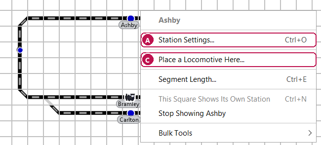

**D. Save.** `Save Changes`, at the bottom of the editor's right-hand column.

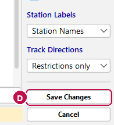

**E. Start.** `Start Autonomous Operation`, on the strip above the track diagram. The train runs to B. When it arrives, TrainControl waits a moment and runs it back to A, and keeps doing that.

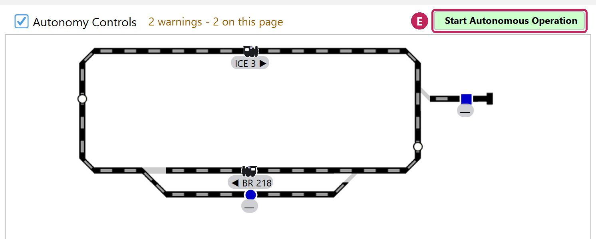

**What happened.** TrainControl traced your diagram, found that A connects to B, saw a train at A, and found exactly one place it could go.

**Try this.** Stop autonomy, and place a second locomotive at B. Start again. Now neither train can move: each wants the station the other is standing on, and a station holds one train at a time. This is the most common reason a layout does nothing; see [When trains will not move](#when-trains-will-not-move).

---

## Example 2: an oval with a passing loop

Two trains and three stations: the first arrangement where TrainControl has a choice to make.

```
              ___________[ C ]___________
             /                           \
    [ A ]===<                             >===[ B ]
             \___________________________/
```

Make the three sensor squares stations and name them, as before, and place a train at A and a train at B.

Press start. A train leaves A. It can reach B two ways, through the loop past C or around the other side, and TrainControl picks one. Meanwhile the train at B can leave too, because its route does not need the track the first train is on.

**What this shows.** TrainControl reserves the track a train needs, and only that track. Two trains run at once here because their routes do not overlap. If they did, the second would wait.

**Try this.** In the editor, click one side of the loop until the message strip says it is closed, or right-click it and choose `Trains May Depart...` → `Closed - No Trains`. Now every train goes past C. With `Track Directions` on `Restrictions only`, closed track is marked on the diagram, so you can see what is not being used.

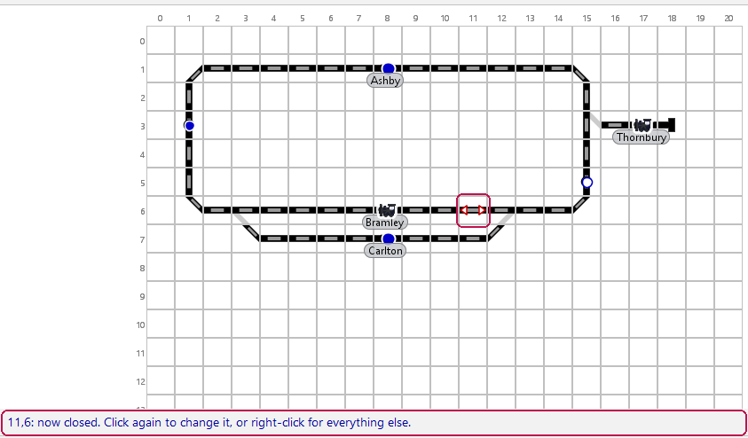

**Try this too.** Right-click C, open `Station Settings...`, open `Advanced`, and set `Importance` higher than the others. Trains now go to C whenever it is free and they have a clear route there; the other stations are chosen only when C is not available. This applies under every routing rule except *Completely at Random*, which ignores importance, and *Weighing Station Importance Against Distance*, which treats it as a weight instead of a rule.

---

## Example 3: a terminus, and trains that must turn around

A terminus is a station where the track stops. A train arriving there must leave the way it came, which means reversing.

```
    [ A ]===========[ B ]===========[ T ]
                                      terminus
```

Make T a station as before. Then right-click it, open `Station Settings...` and click `Terminus`, which sets `Changing direction` to `Must`.

A station at the end of a line has to be set this way. Otherwise the setup check reports it as an error, because a train sent there could never leave.

`Terminus` tells TrainControl two things:

- **Every train that arrives at T turns around before it leaves.** So autonomy sends only locomotives that can reverse there (tick `Reversible` on the `Autonomy` tab of the locomotive's `Locomotive Settings`). You cannot send one that cannot reverse there yourself either, unless T is a parking berth (below).
- **T is the end of the line.** No train is routed through it on the way somewhere else.

Autonomy chooses T like any other station. If T is a parking track or a shunting neck, where trains should not end up at random, click `Parking` instead of `Terminus`. It is the same as `Terminus` with `May choose this station` unticked: autonomy leaves the station alone, but you can still send a train there yourself (right-click the train on the track diagram, and look under `More Destinations`), and [Return Home](#sending-every-train-home) still parks trains there. Like any station where every train turns around, a berth that track reaches from both ends needs one side closed under `May arrive from`, or the setup check stops autonomy until it is.

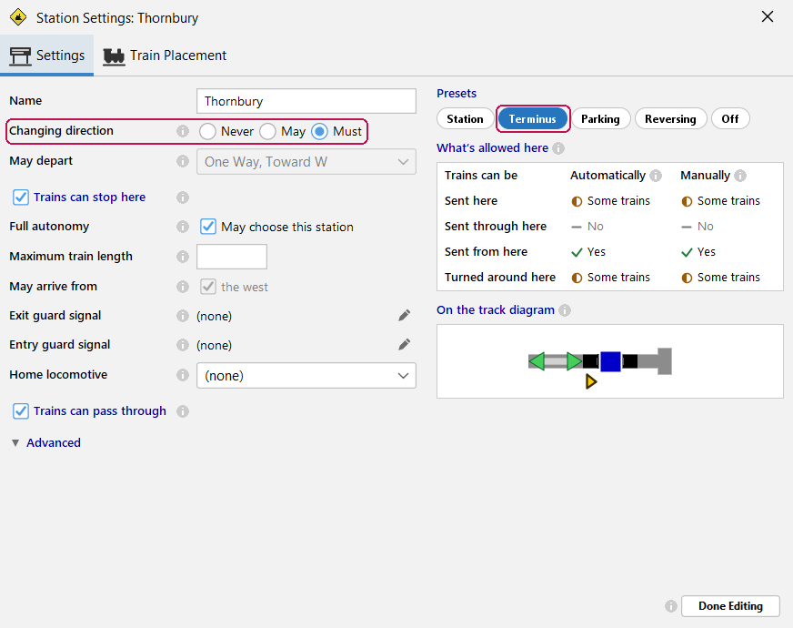

---

## Example 4: a through station that only takes trains one way

Some stations only make sense to arrive at from one direction: a platform on a one-way loop, a bay that faces east, or a station where arriving from the west means fouling a junction.

Right-click the station, open `Station Settings...` and look at **`May arrive from`**. By default a station takes trains from every side. Untick the sides you do not want, and TrainControl only routes trains to it from the sides you left ticked. The last open side cannot be unticked, and a station with only one way in has nothing to choose. Once a side is closed, the window's picture shows an arrow into the station at each side, and clicking one opens or closes that side too.

Set `Track Directions` to `Station Arrivals` to see, for every station at once, the sides it takes trains from.

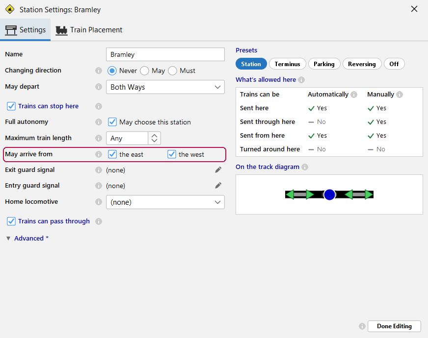

**Where this matters most** is a station that is really two platforms. On the diagram it is one square, but a train arriving from the east and a train arriving from the west need different switches set and occupy different track. Arrival sides say which of those you want.

---

## Track lengths

Nothing above this section needs lengths. A layout with none set works: TrainControl then does not judge whether a train fits anywhere. Lengths only ever **refuse**. They stop a train being sent somewhere it physically will not fit, and they tell TrainControl that a long train standing at a short platform hangs back over the track behind it.

**The unit is yours.** A length is a number, not centimeters. Pick something (a coach, a foot, ten centimeters) and use it everywhere. A train's length and a track's length only have to be counted in the same unit.

**Two numbers that are easy to confuse:**

| | Where you set it | What it means |
| --- | --- | --- |
| A square's **segment length** | Right-click the square → `Segment Length...`, or Control+E with the pointer over it | How much train this piece of track physically holds |
| A station's **maximum train length** | `Maximum train length` in the station's `Station Settings`, or Control+B | The longest train you are willing to have stop here, whatever the track says |

The first is a measurement, the second is a preference. Both are checked, and either can refuse a train. A train's own length is `Train Length` on the `Autonomy` tab of its `Locomotive Settings`; set it for every train at once with `Bulk Tools` → `Mass Assign Train Lengths (... missing)...`. Tick **Track Lengths** under `Visible Elements` to see the measurements on the diagram, and **Unmeasured Track** to see what is still missing. `Bulk Tools` → `Clear All Track Lengths` starts you over.

### What lengths decide

**Whether a train may be sent somewhere at all.** A train longer than the station's maximum is not sent there. A train longer than the measured track leading in is not sent there either, and the message says which of the two refused it.

**Whether a train would come to rest across a set of points.** The question is not "does the train fit between the two sensors" but "does it fit in the part after the last switch", because a train standing on the points blocks every other road through them.

**How much track a standing train occupies.** A train longer than its platform hangs back over the approach, across track that has no sensor of its own. TrainControl blocks that track and draws it: the orange line on the diagram is as long as the train. Without lengths it cannot know this, and two trains can be routed onto the same piece of rail.

**Whether a train can go around a loop without running into its own tail.** A route that goes out around a loop and comes back along track the train is still on is allowed only if the back of the train has gone by the time the front gets there. When such a route is refused, the message gives the longest train that would make it: "send a train of 9 units or shorter, or send this one another way".

Only measured track counts. With nothing measured around the loop, the trip is not checked at all. Where part of the loop has no length, the message says how many more lengths Mass Assign Lengths would ask you for on the way around. Give them, and the trip may turn out to be long enough.

**Which route is picked**, if you have chosen *Over the Shortest Track* or *Over the Longest Track*. Both are measured in your lengths, and a section with no length counts as one, so with nothing measured they pick the route over the fewest, or the most, sections. A section you answered 0 counts as 0.

### What to measure

Measure **the squares a train comes to rest on, and the run back to the switch behind each one**. That is the stretch the rules above ask about, with one addition: **measure the track around any loop a train can be sent around and back onto its own line**, or that trip is not checked. You do not have to measure the rest of the layout, and measuring plain running line that nothing stops on gains nothing.

**Example: a platform with points just behind it.** The run in from the previous sensor is 6, with a switch in the middle: 3 before it, 3 after.

- A **3-unit** train stops clear of the points. Nothing else on the layout is affected.
- A **6-unit** train fits the run in, but stands across the points. This is allowed at a station, because the train will move on. While it is there, anything routed over those points is refused, so if they are the only way to another part of your layout, that part waits.
- A **7-unit** train is refused: it does not fit even the whole run in, so its back end would be somewhere nothing has been measured.

**Example: the same track, used as a parking berth.** A berth is somewhere a train *stays*: a station with **May choose this station** unticked. Here the 6-unit train is refused, because its back end would stand on the points and close that road for the rest of the session, not just for a minute.

> To park long trains, give the berth enough measured track **past** the switch behind it, or park them at a platform instead.

**Example: a platform you want to keep short trains at.** Your platform measures 8 and you never want more than 4 units there. Set its `Maximum train length` to 4. The measurement stays 8, because that is what says whether a train fits; the 4 is your preference on top.

### Measure a whole run, or none of it

An unmeasured square counts as nothing at all, so a half-measured approach understates how much room there is. That is safe, since it refuses more than it needs to. But it also makes a *standing* train look longer than it is, because its back end runs over the unmeasured squares for free and blocks them too.

**Track that really has no length: answer 0.** Two sensors side by side have no track between them. Give that stretch 0 in Mass Assign Lengths or Segment Length (every square of it, including a switch or crossing on it), and it counts as measured track of no length. A train is then let in wherever the measured track holds it in total, and a train standing there is taken to lie over the 0 and on behind it. A stretch left blank is still unmeasured, and still stops the count.

So if a short train seems to block a surprising amount of track, the cause is almost always an unmeasured square behind it. Set its length and the orange line shrinks.

**The square a train is standing on is track, and it is used first.** A 2-unit train on a platform square measured 2 fits on that square and blocks nothing behind it. A 3-unit train there lies one unit back over the track behind the platform, and that track is blocked. How long a train a station will take is a separate setting, its maximum train length, which says only which trains may be sent there.

---

## Running and watching

**Starting and stopping.** `Start Autonomous Operation` is on the strip above the track diagram, on the diagram's right-click menu, and on the Auto tab; in the main window, Control+G does the same. `Graceful Stop` (`Gracefully Stop Autonomy` on the right-click menu, or Control+Q in the main window) lets every train finish the route it is on and then stops. Use it for an ordinary stop, and keep the emergency stop for emergencies. When Control+G cannot start autonomy because the track power is off or the setup is not ready, a message says why; when autonomy is not loaded or trains are already running, the log says so. Control+Q with nothing running does nothing. If no train can be started (each is on a station out of service, or has no speed set), Start says so and does nothing. The `Autonomy Controls` box on the strip shows or hides everything autonomy draws on the diagram.

**Routes while trains run.** While autonomy is running, a route will not move a switch on track a train is running over (setting it the way that train's route already has it is fine), nor turn a signal green at a platform where a train is standing. A route run from the Routes tab or from a route square on the diagram asks once whether to go ahead anyway. A route fired by a sensor skips only those switches and signals and runs the rest, such as speeds and functions. An emergency stop in a route is always sent. When autonomy is stopped, routes run as before.

**Stop before you quit.** Use `Graceful Stop`, wait for the trains to come to rest, then close TrainControl. Where every train stands is saved, and the same configuration loads next time. Closing while trains run leaves them moving with nothing to stop them, so TrainControl asks first.

**A train's route is drawn along the track.** The track ahead of the train is in the stations' blue, the track it has driven and still holds is dark gray, white arrows show which way it is going, and the train itself is orange along the length of track it covers, drawn over its route so its tail shows while it runs. Where routes are not atomic, the dark gray goes as the train gives back the track behind it. The line follows the track through curves and switches instead of cutting across them.

**Each train is drawn as a small locomotive** on its station, pointing the way it faces, whether or not autonomy is running, and on its route while it moves. A train standing still on a route it holds, while its switches are set or while it waits on its way, is drawn the same, where it stands.

**What the marks on the diagram mean.** Each station has a mark on its square, the same on the track diagram and in the editor.

- The shape says whether trains turn around there: a circle where they do not, a diamond where they may (`Changing direction` set to `May`), and a square where they must (`Must`) or where the track runs out.
- The mark is blue, or gray where autonomy will not choose the station by itself (`May choose this station` unticked). It is hollow until the station has a name.
- A white dot in the middle marks a station trains must stop at (`Trains can pass through` unticked); on a hollow mark the dot is drawn in the mark's color.
- A sensor that is not a station gets a smaller mark of the same kind: on every sensor in the editor, and on the track diagram only where trains turn around.
- A station or sensor out of service (both `Trains can stop here` and `Trains can pass through` unticked) shows an orange sign with an X instead: solid orange with a white X on a station, and white with an orange ring and X on a plain sensor.

**Station names are shown on the diagram.** In the editor, right-click a square beside a station and choose `Show a Station Name Here...` (or press Control+N over it); a station square shows its own name. `Station Labels` then chooses what every caption shows: the station, the train parked there, or its home locomotive. A text label typed as `Point:StationName` that names a station the setup knows is turned into a caption, and removed from its page so it is not shown twice. The page keeps a `.bak` copy of itself as it was, and the log names each page changed. To hide the names of stations autonomy will never send a train to, or to draw captions in blue instead of light gray, see **Preferences** → Autonomy.

**A signal paired with a station** (`Exit guard signal` in its `Station Settings`) turns red while a train is standing there, and green again once it leaves.

**While autonomy runs, nothing that changes the setup can be used.** The Autonomy and Layouts menus gray out everything that would change the setup or the track diagram, and say why when you hover over them; the Layouts menu keeps Open CS3 Web App, Show Current Layout Folder and the picture export. On the Auto tab, the settings, `Execute Timetable` and `Capture Locomotive Commands` are grayed until the trains have stopped, with the tooltip "Please wait for all active locomotives to stop."

**The Auto tab** (the third icon on the left of the main window) is grayed until a configuration is loaded. When none is loaded (after `Stop Using Autonomy`, or with `Load Autonomy` unticked under Preferences → Startup), the strip above the track diagram offers `Load this configuration`. Once a configuration is loaded, the Auto tab has three tabs:

- **Autonomous Locomotive Commands**: `Start Autonomous Operation`, `Graceful Stop` and `Return Home`, and a card for each train saying where it is and where it can go.
    - The cards are sorted when you open the tab and when the list is rebuilt (when a train is placed or renamed, for example), not when you press a pause button: trains that are going first, then paused trains, then trains on stations that are switched off, each group by name.
    - Double-click a destination to send the train there yourself.
    - Hover over "No available paths" to see, for each station, why the train cannot go there, or click it for the whole list in a window.
    - After a station's name, `*` marks the timetable's starting station, and `-` a station autonomy will never choose for that train. A train standing at its own home has a small house beside the line below its station.
- **Timetable**: see [Timetables](#timetables).
- **Settings**: see [Autonomy settings](#autonomy-settings).

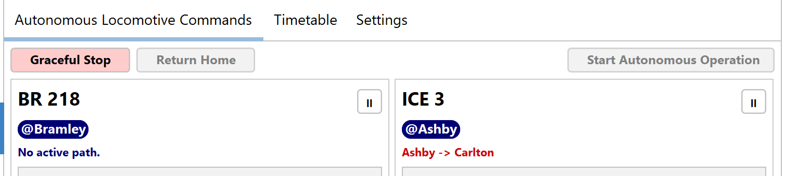

**On the track diagram**, right-click a train to send it to one of the stations autonomy chooses from, or to one under `More Destinations`, which lists the stations you have unticked `May choose this station` on, such as parking berths. A standing train's stations are offered even while another train you sent this way is still on its way, as on its card on the Auto tab, but not while autonomy, a timetable or Return Home runs. Its stations are listed by name, with numbers counted as numbers, so ParkingTrack4 comes before ParkingTrack10.

Right-click a station to place the train selected in the main window there (`Place` *train* `Here`), to take a train off, or to open the train standing there: `Edit` *train* `...` opens its `Locomotive Settings` on the `Autonomy` tab, and `Change Train at` *station* `...` opens [the Train Placement tab](#the-train-placement-tab) of `Station Settings`. Placing a train from the diagram may ask which way it faces and which way it came in; if you are not sure, take the suggestion.

When you send a train that can reverse to a station where trains may change direction, TrainControl first asks "Keep direction?". Yes, the default, keeps it facing the way it is; No turns it around there.

The diagram's right-click menu opens the same `Station Settings` as the editor, but changes made there are saved at once, with no Cancel, and while autonomy runs the window is read only. With autonomy stopped, you can also move trains from the keyboard: point at a station and press Control+X to pick its train up, Control+V to put it (or the locomotive selected in the main window) down, or Delete to take it off.

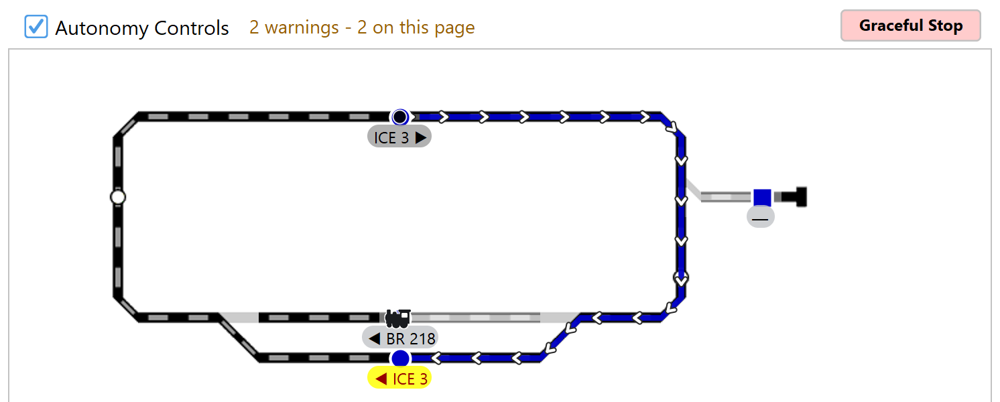

---

## Trying it out without a Central Station

Autonomy can run in simulation: trains move on the diagram, but nothing is sent to a Central Station and no real train moves. Use it to check that your stations, routes and settings do what you meant, without powering up the layout.

1. **Start TrainControl with debug and simulation on.** Open the folder you normally start TrainControl from, the one with `TrainControl.jar` (your locomotives and window settings are kept there). On Windows, click the File Explorer address bar, type `cmd` and press Enter. In the window that opens, run `java -jar TrainControl.jar 0 debug simulate`. If it says `java` is not recognized, install Java first ([Requirements](Readme.md#requirements)). All 3 words after the jar's name must be there: the first stands for the Central Station's address and is not used, the second turns on debug mode, and the third turns on simulation. Double-clicking the jar passes none of them, so to start this way again, save the command as a `.bat` file (`.sh` on Mac and Linux) in that same folder.
2. **Tick `Simulate`.** With a configuration loaded, open `Autonomy` → `Autonomy Settings...` and tick it. It is grayed out while trains are running, and refused if TrainControl was not started as in step 1. TrainControl may tell you it has turned on `Echo Sent Commands` (Preferences → Debug), which simulation needs.
3. **Start autonomy as usual.** If `Simulate` is not ticked, Start warns that the trains will never move and asks whether to go ahead.

**What happens.** Trains are sent as usual, but TrainControl answers for the sensors. After a random wait between `Minimum Action Delay` and `Maximum Action Delay` (in seconds), it reports each sensor on a train's route as occupied, and after another such wait it clears it behind the train. Lower the delays to go faster, and put them back before you run real trains: they also set how long a real train waits before leaving. Nothing on your layout takes part, so a simulation checks your setup and not your hardware. A sensor drawn on the wrong square, a dead sensor, or a switch that does not answer will not show up, and `Path Integrity Validation` is skipped.

**Afterward.** Your real trains have not moved, but TrainControl saves where the simulated ones finished. Stop autonomy and use `Return Home` before you close, or place the trains again where they really stand. `Simulate` is saved with the configuration; when you start TrainControl normally, it loads unticked and the log says why. To go back to normal, close TrainControl and start it as you usually do.

---

## Choosing how trains pick their route

When more than one route will do, TrainControl has to choose. The **Routing Logic** dropdown on the Auto tab's Settings (`Autonomy` → `Autonomy Settings...`) sets how:

| Setting | What it does |
| --- | --- |
| At Random, Respecting Importance | Picks any of them, most important stations first. This is the behavior TrainControl has always had, and it stays the default |
| Completely at Random | Picks any of them, to any station; station importance is ignored |
| Past the Fewest Stations | The most direct route |
| Past the Most Stations | Trains pass more stations on the way instead of going straight there |
| Over the Shortest Track | By measured length; a section with no length counts as one, and one answered 0 as 0 |
| Over the Longest Track | The scenic route |
| Across the Fewest Sensors | Fewest reporting points on the way |
| Across the Most Sensors | The busiest-looking route |
| Least Recently Visited | For a layout with a favorite loop, so the far corner still gets visited. Station importance still applies first |
| Weighing Station Importance Against Distance | The one rule that crosses importance levels: a near ordinary station can beat a distant important one |

The "most" and "longest" settings are for a layout that should look busy instead of efficient. On a small layout they keep a train from shuttling back and forth between the same two stations.

The choice is saved with the autonomy configuration, so two configurations can use different rules. Stations you have given a higher importance are chosen first under every rule except *Completely at Random*, which ignores importance, and *Weighing Station Importance Against Distance*, which trades it against how far away a station is.

---

## Timetables

Autonomy on its own picks trips at random. A timetable is a sequence of trips you record once and play back the same way each time. It is on the Auto tab's **Timetable** tab.

**To record one:** press `Capture Locomotive Commands`, then either start autonomy or send trains yourself. Every completed route is recorded, with how long it was before the next one started. Press the button again to stop recording.

**To play it back:** press `Execute Timetable`. Each entry starts once the one before it has set off and the recorded pause has passed, and as soon as the track it needs is free. If that track stays blocked for a few minutes, the timetable stops and says which entry.

**To edit it:** right-click an entry for `Change Delay`, `Delete Entry`, `Restart Timetable` and `Clear Timetable`.

**Recording adds to the timetable.** Capturing again adds to what is already there instead of replacing it, so clear the timetable first if you want to start over.

**A timetable needs the trains where they were.** It is recorded from one arrangement of trains. Play it back with the trains somewhere else and the first entry will not run, because the train it names is not where it was. If an entry cannot be run, the timetable stops there and says which entry and why.

Record a timetable that ends where it began, and you can run it again and again.

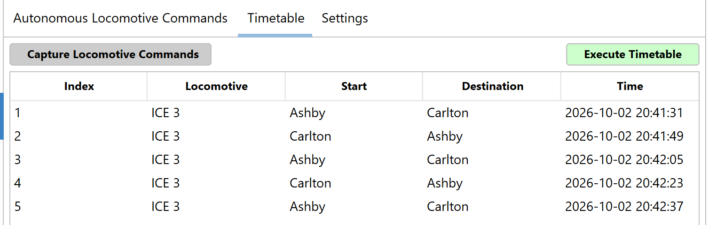

---

## Sending every train home

`Return Home` on the Auto tab, or `Return Locomotives Home` on the track diagram's right-click menu, sends every locomotive back to the station it belongs at. Control+H in the main window does the same, after asking first. By default a train's home is the station it was standing on when the configuration was loaded. To change it, use `Home locomotive` in a station's `Station Settings` (or Control+H over the station in the editor), or set every train's home at once with `Bulk Tools` → `Home All Trains Where They Stand`.

A station holds one train at a time, so a train cannot go home while another is standing there. TrainControl works out an order that succeeds, moving trains out of each other's way and bringing them back afterward where needed. It works out the same plan on any computer, and on a crowded layout it may think for up to about 15 seconds before the first train moves.

Trains must be stopped first, so use `Graceful Stop` if autonomy is running. The button is grayed when there is nothing to do, and its tooltip says why. If no arrangement can be found, you are told so and nothing moves. A paused train stays where it stands, and the others are worked around it.

To put every train back on its home without driving anything (after moving them by hand, say), use `Bulk Tools` → `Place All Trains at Their Homes`, or right-click `Return Home` and choose the same item. It asks first, and you then move the real trains to their homes yourself. It is grayed, with the reason in its tooltip, while anything is running (autonomy, a timetable, Return Home or a route) or an editor is open. The same right-click menu also has `Run Trains to Their Homes` above it, which is the same as pressing the button.

To see the homes on the diagram, set `Station Labels` to **Home Locs**: each station caption then names its home locomotive, on an ordinary caption when that locomotive is standing there, and in white on dark gray when it is somewhere else. Return Home moves every train on a dark gray caption. It also moves a train standing on its own home but turned the wrong way (where the home was set facing a way), which the caption, comparing names only, draws as an ordinary one.

---

## Autonomy settings

These are on the Auto tab's **Settings** tab; `Autonomy` → `Autonomy Settings...` opens it. They are saved with the configuration. Most layouts change two or three of them at most, and none can be changed while trains are running.

**Timing and speed**

| Setting | What it is for |
| --- | --- |
| Minimum and Maximum Action Delay | How long a train waits before leaving again, in seconds. It is a range, so departures do not fall into lockstep. In a simulation they also pace the simulated sensors |
| Default Locomotive Speed | Used for a locomotive with no preferred speed of its own |
| Pre-arrival Speed Multiplier | How much a train slows on the approach. This is what the sensor before the stopping point is for |

**Which trains run, and where to**

| Setting | What it is for |
| --- | --- |
| Maximum Active Trains | How many run at once. Zero means as many as the track allows |
| Prioritize Locomotives After | A train that has not run for this many minutes is chosen first, so no train is forgotten. Zero is off |
| Routing Logic | See [Choosing how trains pick their route](#choosing-how-trains-pick-their-route) |

**Safety**

| Setting | What it is for |
| --- | --- |
| Atomic Routes | Whether a train reserves its whole route before setting off, or releases track behind it as it goes. Off lets more trains run and needs your lengths to be right, so it stays on while any track autonomy uses, or any train, has no length |
| Maximum Network Latency | Cuts track power if the network to the Central Station gets too slow. Off by default |

**Functions and routes**

| Setting | What it is for |
| --- | --- |
| Turn Off Functions on Arrival, Turn On Functions on Departure | On departure, switch on the locomotive's saved function preset (right-click the locomotive → `Save Active Functions as Preset`, or Alt+S); on arrival, switch all its functions off. Untick the arrival one to keep sound running between routes. Separately, one function can be toggled as each train leaves and one as it arrives, whatever these two say: set `Departure Function` and `Arrival Function` on the `Autonomy` tab of the locomotive's `Locomotive Settings` |
| Linked Routes | `Toggle specified routes`: the routes ticked in the list are switched on and every other route is switched off, and they stay that way after autonomy stops. This happens whenever this configuration is loaded (including after a page edit, or a Sync that finds a page changed), whenever autonomy starts a run, a timetable or Return Home, and as soon as you tick a route. A route you switch by hand meanwhile goes back to the list at the next of these. Use it for emergency stops, sound effects, or safety signals. Only routes triggered by a sensor can be switched on this way |

**Testing**

| Setting | What it is for |
| --- | --- |
| Simulate | Runs autonomy with no Central Station, to try a setup. Only when TrainControl was started in simulation: see [Trying it out without a Central Station](#trying-it-out-without-a-central-station) |

Per-station settings (importance, speed, train length, which trains are kept out) are in the station's `Station Settings`.

A few more autonomy settings are under Preferences → Autonomy, because they belong to this computer and not to the configuration:

- `Path Integrity Validation` (on, and recommended) makes each train wait until the Central Station confirms every switch and signal on its route. If it cannot, the train does not leave, autonomy tries again, and a message names the accessories. While the Central Station is still switching other accessories, the train waits longer for its own, up to 30 seconds.
- `Display Travel Restrictions` and `Display Allowed Directions` draw the red and green direction marks on the ordinary track diagram.  A station that lets trains leave every way, the default, draws no green, on the diagram and in Station Settings' picture alike; a station with a red side keeps its green ones beside it.
- `Show Inactive Labels` and `Gray Station Labels` decide which station captions are shown, and in what color.

---

## Configurations

A configuration is one way of running your railway. Everything about configurations is on the Autonomy menu:

- `Configuration (`*name*`)` lists them; pick one to load it.
- `Manage Configurations` → `Import...` brings one in from a file, including an `autonomy.json` from an older version, and `Export...` saves the one loaded.
    - An older `autonomy.json` brings its stations, trains and settings across. Its timetable, its route activations, and each connection's commands, lengths and locks (which the track diagram decides now) are left behind, and the import lists what it left.
    - Imported into a configuration that already exists, an older file only fills its gaps. A setting at its default, a home taken off, or an emptied exclusion list counts as not set and takes the file's value. Each station of a configuration that has been loaded keeps its own maximum train length, even where that is no limit.
- The first configuration is made with `Add a Configuration...`: no trains placed, every station rule and setting at its default, and no timetable.
- After that, `Manage Configurations` → `New Configuration...` makes a blank one from the stations and settings you have, with no locomotives placed and no timetable, and `Save As...` duplicates the one you have, trains' places and timetable included. `Save As...` can also replace another configuration of the same layout: after a warning that names it, and only if you confirm; the one you have loaded cannot be replaced. The one you have stays chosen; pick the new one from the Autonomy menu when you want it. `Rename...` and `Delete...` are beside them.
- Also under `Manage Configurations`: `Stop Using Autonomy` unloads the configuration without deleting anything, and `Delete This Layout’s Whole Autonomy Setup...` removes every configuration, with every station name, direction and caption; the track diagram itself is not touched. After `Stop Using Autonomy`, the strip above the diagram offers `Load this configuration`.
- `Pages with Autonomy Enabled` says which pages autonomy uses.

None of these can be done while autonomy or a route is running. The configuration you used last is loaded when TrainControl starts, unless `Load Autonomy` is unticked under Preferences → Startup.

### Several configurations on one layout

**Shared by every configuration** (the railway itself):

- which squares are stations, and their names and captions
- the direction of each piece of track, and its length
- the links between pages: which are paired, which are switched off, and their names
- which ways into a station are open, blocking stations, and signals
- which pages are in autonomy (`Pages with Autonomy Enabled`)

Change any of these and every configuration sees the change.

**Kept separately by each configuration:**

- where each train stands, which way it faces, and the track it came in on
- which trains are paused (`Is Active`, or the pause button on the Auto tab)
- whether trains may or must change direction at a station (`Changing direction`)
- whether trains can pass through a station at all, whether full autonomy may choose it as a destination, and so whether it is a parking berth
- each station's home locomotive, longest train, importance, speed and the locomotives kept out of it
- the settings in [Autonomy settings](#autonomy-settings), including how trains pick their route, and the timetable

So two configurations can offer different routes over the same track. Whether trains may or must change direction at a station changes the routes that use it: where trains *may* change direction, autonomy can also turn trains around there; where they *must*, every train that arrives turns around. Autonomy and the trips you send by hand never route through a station trains cannot pass through. What two configurations cannot differ in is the track itself, its directions, its links, or which pages are in play: those belong to every configuration at once.

---

## When trains will not move

Read this section first when nothing happens. The causes are grouped by where the trouble lies, and in each group the most common comes first.

**Two places tell you why.** On the Auto tab, hover over "No available paths", or click it: it shows the same table as Why not Moving?, with every station the train might be sent to, whether it can go there now, by hand only, or not right now, and why. In the editor, **Why not Moving?** answers the same question on the diagram; see [Test a path, Why not Moving? and One-Way Run](#test-a-path-why-not-moving-and-one-way-run).

The log names the train, the route, and the reason, too.

### Nothing is sent at all

**The setup has an error.** Errors stop autonomy starting and stop trains being sent by hand. They are listed under **Must be fixed** in the editor, and clicking the count on the strip above the diagram opens the editor on the first one. See [The setup check](#the-setup-check).

**The track power is off.** Start, Execute Timetable, Return Home and every train you send by hand are refused until it is on: "To start autonomy, please turn the track power on, or cycle the power." If the power goes off while autonomy, a timetable or Return Home is already running, nothing new is sent, the log says autonomy is waiting for the power, and the run carries on by itself once the power is back. This includes a short circuit: when the Central Station cuts the power after one, TrainControl shows the power as off, and a warning names the output that tripped.

**The connection to the Central Station was lost.** TrainControl talks to a CS3 over TCP. If the CS3 won't take TCP, TrainControl uses UDP instead, which can add up to 2 seconds to starting up.

- If the connection drops (a network cable pulled, say, or the CS3 answering nothing for 3 seconds after a command), every command goes over UDP at once, while TrainControl tries three times to reconnect over TCP. If it can't, it stays on UDP until you restart it.
- After it reconnects, no S88 route is set off until the Central Station has reported the state of every sensor again. Nothing is held back or sent again, because the handset or another computer may have commanded the train since: the log only counts the commands that may not have arrived.
- While it reconnects, autonomy, a timetable and Return Home start no new trip, a train you send is refused with the reason in the log, and trains already on their way carry on. The log says when trips are held and when they start again.
- While the Central Station isn't answering, the main window shows a warning triangle in its lower right, past the function tabs, and the network latency names the protocol in use: `(TCP)` while a CS3 is on TCP, and `(UDP)` for a CS2 or once TrainControl has switched to UDP.

**The autonomy editor is open.** No train is sent while it is open, so Save or Cancel first. Linking a multi-unit, changing an address or decoder, `Sync Database w/ Central Station`, and a locomotive CSV import that changes addresses are also refused until then, with a message; switching, creating or downloading a layout and the `Autonomy` menu's configuration items are grayed. A sync that a route edit or a function reset runs afterward waits, and runs once when the editor closes.

**A route is running.** Start, Execute Timetable, Return Home and every train you send by hand are refused until it has finished, with a message naming it: "The route ... is running.  Wait for it to finish, then try again." With several routes running, the first few are named. Routes that a sensor fires while autonomy is already running do not stop it.

**Autonomy stopped by itself.** When a train fails partway along its route, it is stopped, its track is released, and autonomy stops, naming the train. Check where that train is really standing, and if TrainControl has it somewhere else, correct it before you start again. A train that has not reached its next sensor after five minutes is named in the log.

**Maximum Active Trains is reached.** Autonomy starts no more trains until one arrives. Trains you send by hand do not count.

### The way is blocked

**Every station is occupied.** A station holds one train at a time, and a train can only go to a station that is free. On a layout with as many trains as stations, nothing can move. Take a train off, or add somewhere for one to go.

**Track that is needed is closed.** Closed track is marked on the diagram with `Track Directions` on `Restrictions only`, and a page link switched off with `Autonomy Uses This Link` is grayed. Check the route you expect the train to take, or ask `Test a path`.

**A station trains may only stop at is in the way.** With only `Trains can stop here` ticked, no trip runs through the station, so a route that has to pass it is not offered. Tick `Trains can pass through` if trains should be able to pass; Return Home may run through such a station either way.

**A train is standing somewhere in the way.** Not necessarily on the route itself: a train occupying a crossing or a shared block can hold up a route that only passes nearby. A long train standing at a short platform reaches back further than it looks: the orange line on the diagram shows how far, and **[Track lengths](#track-lengths)** explains what to measure.

### One train is left out

**The train has nowhere to go.** Look at the train's card on the Auto tab: it says so for each train. A train whose only destinations exclude it, are the wrong direction, or are too short for it has no route.

**The train is paused.** A train is paused by the pause button on its card on the Auto tab, by unticking *train* `Is Active` on the right-click menu of the station it stands at, or by `Active` on the `Train Placement` tab of `Station Settings` or in `Locomotive Settings`. Autonomy skips it and Return Home leaves it where it stands until you press the button again or tick the box. A paused train is drawn gray on the diagram.

**The destination is one autonomy may not choose.** Autonomy never chooses a station with `May choose this station` unticked, nor, for a locomotive that cannot reverse, a station where every train turns around. See [Example 3](#example-3-a-terminus-and-trains-that-must-turn-around). `More Destinations` on the train's right-click menu still takes a train to the first kind by hand.

**The train is too long for everywhere it could go.** If you have set lengths, a train can run out of destinations just by being long, and the tooltip on "No available paths" says so for each station in turn. Check that the measurements are right before you shorten the train.

**It is facing a way that leads to no station autonomy may choose.** A train standing on a platform facing a way whose track leads only to sensors, turning points or parking is never sent anywhere by autonomy. Why not Moving? says so, and what would help:

- where the platform's other way leads to a station autonomy may choose, and a train may start from it: turn the train around;
- where the other way leads to one, but trains may not arrive at the platform facing that way: open that side under `May arrive from` in its `Station Settings`, and turn the train around, unless every train turns around at that platform (that side cannot then be opened, and the train is driven off by hand);
- where autonomy starts no train facing the other way for another reason: drive it off by hand;
- where neither way leads to a station autonomy may choose: drive it off by hand, or let autonomy choose a station it can reach: put that station back in service, tick `May choose this station`, and open the side a train would arrive on under `May arrive from`, unless every train turns around there.

### The railway does not answer

**The sensor is not reporting.** If TrainControl never sees the arrival, the train stays "running" forever and the track it holds is never released. Click the sensor square on the track diagram that the train was heading for: a left-click there switches the sensor as if the train had reached it, so TrainControl sees the arrival and the run carries on. Then find the faulty contact by watching its square while you push a train over it by hand.

**The Central Station does not confirm the switches.** With `Path Integrity Validation` on (Preferences → Autonomy), a train whose switches and signals are not confirmed does not leave. Check the network connection to the Central Station.

**A switch or signal on the route is not in the database.** A route is not used if one of its accessories is missing, because otherwise a train would run over track that was never set.
